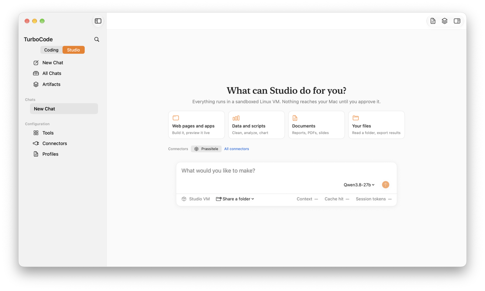
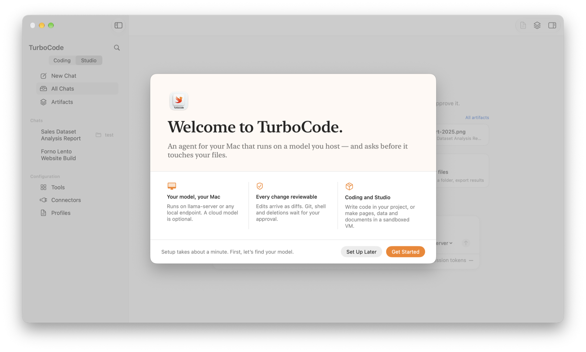
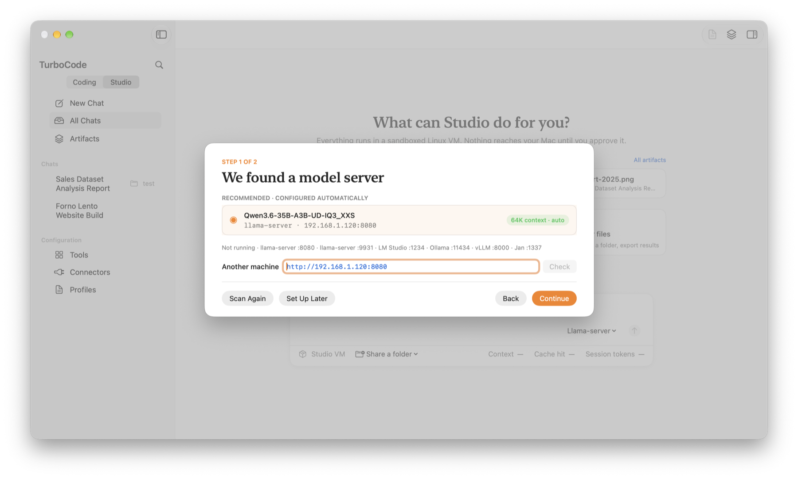
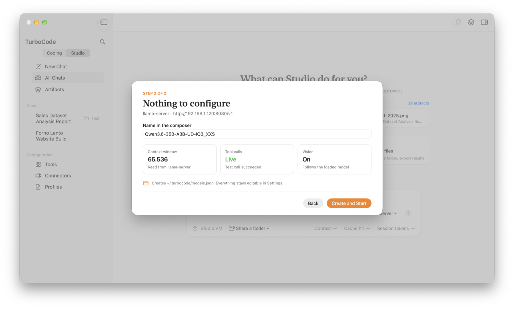
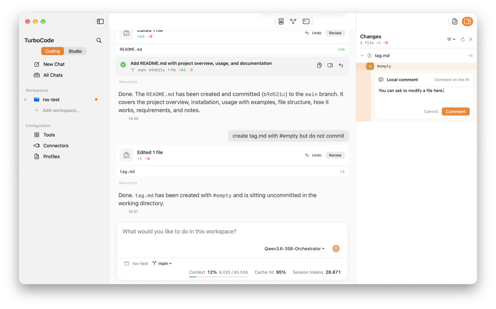
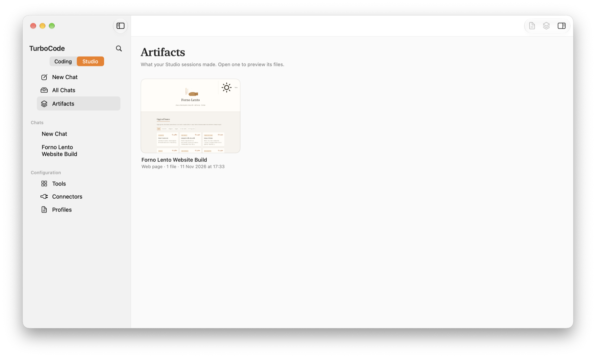

turbocode / overview

<h1 id="overview">TurboCode</h1>

A compact, fast agent harness for macOS, written in Swift. It runs on a model you host, and asks before it touches your files.

<figure class="hero"><figcaption>Studio home in 0.65. A card writes a starter prompt; the home view never starts the VM.</figcaption></figure>

TurboCode is an open-source project built by one person, a character artist and digital sculptor who writes Swift. It uses less than 200&nbsp;MB of RAM when idle, which leaves more memory for the GPU when the model runs locally. There is no JavaScript in its core: model I/O, typed tool calls, routing and safety are all Swift.

<b>Where it stands.</b> With version 0.65, TurboCode has reached a good set of the features I wanted, and good robustness. Maintenance is steady but doesn't follow a rigid development plan: it fits around my other commitments.

<h2 id="install">02Install</h2>
<pre>brew install --cask granvalenti76/homebrew-tap/turbocode</pre>

Update with <code>brew upgrade --cask turbocode</code>. Requires macOS 27 on Apple silicon.

<b>Note:</b> the app is ad-hoc signed and not notarized. If macOS blocks the first launch, right-click it and choose Open.

<h2 id="first-launch">03First launch</h2>

TurboCode looks for a model server on your Mac or local network (llama-server, LM Studio, Ollama, vLLM, Jan), checks the context window, tool calls and vision, and writes <code>~/.turbocode/models.json</code> when you choose <em>Create and Start</em>.

  <figure style="margin:0"><figcaption>1 · Welcome</figcaption></figure>
  <figure style="margin:0"><figcaption>2 · Server found</figcaption></figure>
  <figure style="margin:0"><figcaption>3 · Model checked</figcaption></figure>

<h2 id="coding">04Coding</h2>

Works in any repository on your Mac. Tools are explicit and appear in the transcript as they run:

<ul><li>file inspection, search and revision-aware edits</li><li>commands, with approval outside the workspace</li><li>Git status, branches, commits and remotes</li><li>Xcode and SwiftPM builds, tests and diagnostics</li></ul>
<figure><figcaption>Press + on a changed line to leave a comment. Comments are sent together; the agent edits only those lines.</figcaption></figure>

A session can also hand a self-contained subtask to a worker model, tracked and verified before it returns. Most sessions don't need it.

<h2 id="studio">05Studio</h2>

An isolated Debian 12 VM on Apple Containerization, with Node.js 24, Python 3.11 and headless Chromium. Enable it in <em>Settings › Studio</em>; the first install downloads about 760&nbsp;MB.

<ul><li><code>/work</code>: one shared Mac folder, read-only</li><li><code>/out</code>: results, copied only through Review &amp; Export</li><li>servers left running open as live pages beside the chat</li><li>models with vision can look at their own screenshots</li></ul>
<h3 id="vision">Vision</h3>

Models with vision can look at images inside the VM: a photo you drop in the chat, a picture they downloaded, or a screenshot of the page they just built, so they can check their own work.

<figure class="wide">
  <video controls muted playsinline loop preload="metadata" poster="/assets/images/turbocode/studio-vision-poster.jpg"><source src="/assets/video/turbocode-studio-vision.mp4" type="video/mp4"></video>
  <figcaption>Qwen3.6-35B-A3B describes a photo in a Studio session. 12 seconds.</figcaption>
</figure>
<figure><figcaption>The Artifacts library: one card per session.</figcaption></figure>

<h2 id="models">06Models</h2>
<table>
  <thead><tr><th>Backend</th><th>Use</th><th>Setup</th></tr></thead>
  <tbody>
    <tr><td>Local Llama</td><td>Recommended</td><td>llama-server or any OpenAI-compatible server</td></tr>
    <tr><td>Apple on-device</td><td>Titles, progress answers, small tasks</td><td>Nothing; about 8k tokens</td></tr>
    <tr><td>OpenAI Codex</td><td>Frontier, when needed</td><td>Codex CLI, browser sign-in</td></tr>
    <tr><td>DeepSeek API</td><td>Frontier, when needed</td><td>Key in the Keychain</td></tr>
  </tbody>
</table>

The recommended setup is <code>llama-server</code> with Qwen3.6-35B-A3B or better. I've tested TurboCode with that model and with the dense <code>Qwen3.8-27B-GSQ-RCO-IQ2_XS.gguf</code> on a MacBook with M4 and 16&nbsp;GB of memory: with the KV cache quantized to q8, the dense 27B runs at about 10 tokens per second. A local model server is still recommended.

<h2 id="safety">07Safety</h2>
<ul><li>Edits are revision-bound and shown for review; destructive file and Git operations need confirmation.</li><li>Studio commands never fall back to the Mac shell; no credentials or Mac environment variables enter the VM.</li><li>Credentials live in the Keychain; remote requests go only to the backend you pick.</li></ul>

<h2 id="extend">08Extending</h2>

Profiles keep prompts minimal and give each role only its tools. Add Markdown Skills globally or in <code>.agents/skills</code>, instructions in <code>AGENTS.md</code>, and optional TypeScript plugins with <code>@granvalenti/turbocode-sdk</code>. TurboCode can also act as an ACP agent inside Xcode.

<h2 id="releases">09Releases</h2>
<table>
  <tbody>
    <tr><td>0.65</td><td>12 Nov</td><td>First-launch setup, live progress answers, Studio skills</td></tr>
    <tr><td>0.64</td><td>10 Nov</td><td>Studio, Artifacts library, connectors</td></tr>
    <tr><td>0.63</td><td>8 Nov</td><td>Image input for local models</td></tr>
    <tr><td>0.1</td><td>29 Jul</td><td>Initial public preview</td></tr>
  </tbody>
</table>

<a href="{{ '/turbocode/changelog/' | relative_url }}"><small>Read next</small>Full changelog</a><a href="https://github.com/granvalenti76/TurboCode/blob/main/CONFIGURATION.md" style="text-align:right"><small>Then</small>Configuration →</a>

