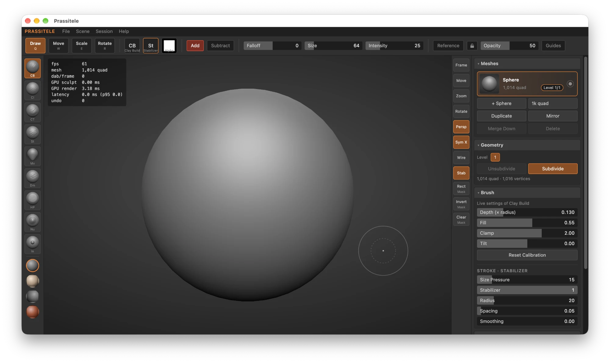
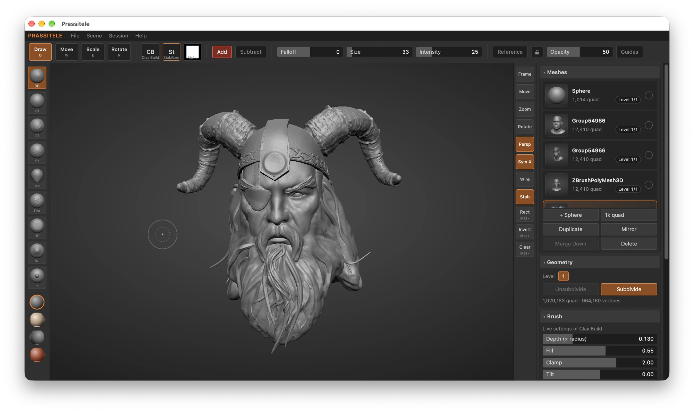
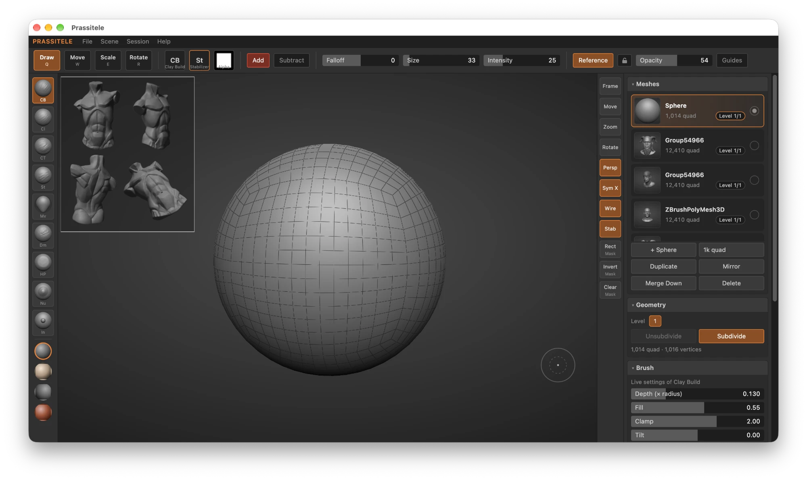

In digital sculpting there is a precise moment when the tool disappears. The hand follows the form, the surface responds, and for a few minutes you stop thinking about the software. A single moment of lag is enough to break it.

**Prassitele** was built to protect that moment. It is a digital sculpting app, started as an experimental project, that works on dense meshes, well beyond ten million polygons, without slowing down. It does nothing else, by choice.

Around this core, from the very first day, there is an MCP server: a way for an AI agent, local or in the cloud, to work alongside the sculptor. The agent prepares the blockout, traces guides on a photo, arranges the references. The form, however, is always decided by the hand.

Prassitele will soon be open source.

## Less, to go faster

The name comes from Praxiteles, the Greek sculptor. It is also a statement of intent: an app for sculpting, and nothing else.

There are no UVs, no painting, no rigging or animation, and no elaborate rendering. Every feature left out is memory and computing time given back to sculpting. A general-purpose app has to balance dozens of workflows. One that does a single thing can build everything, from the interface to memory management, around a single gesture.

That restraint is what makes the speed possible.

## Sixty-four million polygons on a laptop

Prassitele stays fluid beyond ten million polygons and goes up to sixty-four million, even on a MacBook Air M4 with 16 GB of memory.

This is the part that took the most work, and the part you see the least. Almost everything happens on the GPU. A brush stroke costs as much as the vertices it touches, not as much as the whole mesh, so it stays light even when the sculpture becomes huge. Catmull-Clark subdivision runs on the GPU too, taking a sphere from a thousand to sixty-six million quads in about two tenths of a second.

The levels also stay connected. You step down to a low level to move a mass, and the detail of the higher levels follows it.

## A gesture your hands already know

Speed is not enough if the gesture does not feel right.

That is why Prassitele has few brushes: Clay Build, Clay, Clay Strips, Standard, Move, DamStandard, Polish, Nudge and Inflate, plus Smooth and Mask. Each one is calibrated to give back what you expect from real clay, with a stabilized stroke and pen pressure on size. Fewer choices, all of them reliable.

The shortcuts follow the same idea. Anyone who has been sculpting for years has them in their fingers, and Prassitele uses ZBrush's: S, U and O for size, intensity and falloff, B and two letters for the brush, Shift to smooth, Alt to subtract, Cmd to mask. You open the app and start working, with nothing to relearn.

## The sculptor's table

A sculptor works with references close at hand. In Prassitele you simply drag an image onto the main view: it stays there, over the sculpture, with its own position, scale and adjustable opacity. With the lock closed, the sculpture turns while the photo stays still.

This table is where the agent comes in.

## An assistant, not a sculptor

The MCP server is turned on from **Agent → Agent Server (MCP)** and accepts any compatible client, with a local or a cloud model. It offers 24 tools that think in millimetres: adding primitives, moving and scaling regions, making brush strokes, measuring sections, remeshing, saving checkpoints and undoing.

The tools are the hands. The craft comes from two skills.

The first builds the blockout of a head: a skull of blocks, soft masses over it, a single remesh that fuses them, with idealized proportions or proportions taken from a photo. The second reads a reference photo, traces its outline, measures how far the sculpture deviates from it, and draws guides on the bony landmarks.

In practice, this is how I work. From [TurboCode](/turbocode/), which already has a Prassitele connector, I ask for the blockout of a head with typical proportions. Then I hand it a screenshot of a face and ask it to trace the guides. References can be handled in words too: “move the photo to the top left”, “set the opacity to 50%”.

All of this speeds up the early stage, and it is optional. The agent does not sculpt details and does not decide the form: it prepares the ground, measures, points things out. Then you pick up the brushes.

## Under the hood

Prassitele is written in TypeScript and runs on Electron, with brushes and rendering on WebGPU. I chose this stack for portability: the same code runs on macOS and on Linux. I tested it on Fedora, and it behaves exactly the same, just as smoothly.

## Open source, soon

Prassitele will be released on GitHub soon under the GPL v3. The first builds are for macOS, designed for Apple Silicon; on Linux it runs from source.

Besides the brushes, it brings only what the work needs: several meshes in the same scene, remeshing into regular quads, a gizmo that can move just the unmasked part, procedural alphas for pores, wrinkles and scales, OBJ import and export. And session recording, which saves every sculpture as a PNG you can replay step by step.

The goal is still the one from the first day: to make the tool disappear.
