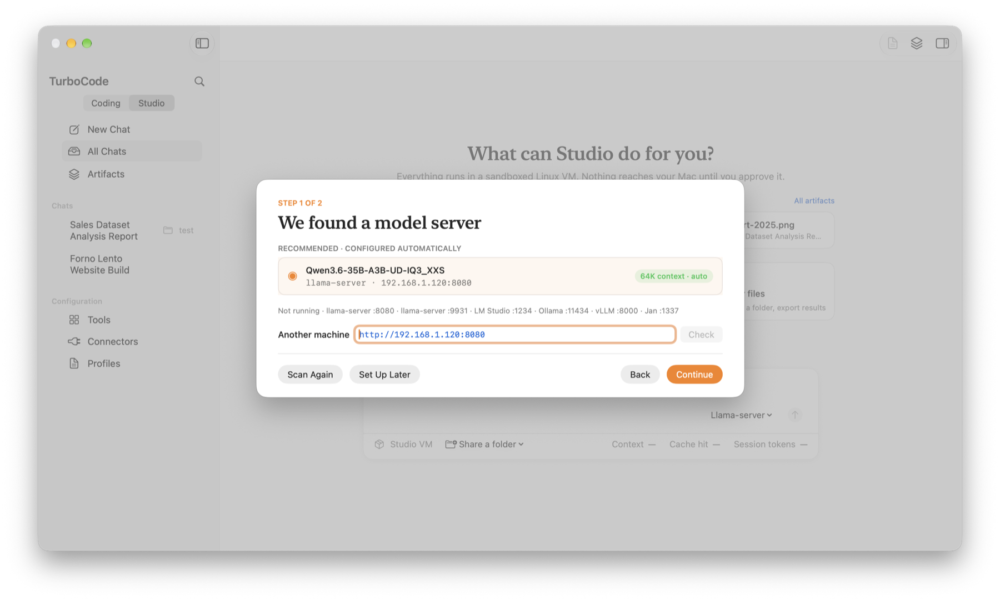
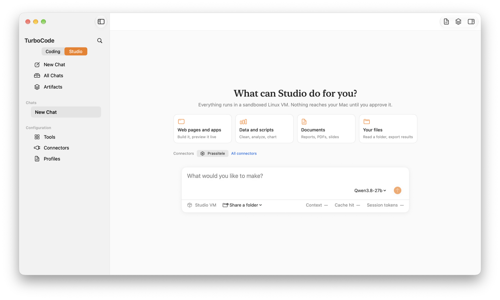

        <header class="docs-header">
            
turbocode / documentation · version 0.65

            <h1>Using TurboCode</h1>
            
Install the app, connect a model, and run your first task in Coding or Studio.

            

                <a href="#install"><strong>New here?</strong>Install the app and pick a backend.</a>
                <a href="#local-server"><strong>Running a local model?</strong>Set up <code>llama-server</code> in six steps.</a>
                <a href="#session"><strong>Ready to work?</strong>Follow a session from request to review.</a>
            

        </header>

        <section class="docs-section" id="get-started" aria-labelledby="get-started-title">
            <h2 id="get-started-title">Get started</h2>

            <h3 id="requirements">Requirements</h3>
            <ul>
                <li>macOS 27.</li>
                <li>Optional: Xcode 27 and Swift 6, only if you ask TurboCode to write Swift programs and use its Swift-specific tools.</li>
                <li>Optional: Node.js 24 or later for TypeScript plugins.</li>
                <li>Optional: a Mac with Apple silicon and about 2.2 GB of free space for Studio.</li>
            </ul>
            
For Swift work, install the full Xcode suite: the Command Line Tools alone are not enough for these tools, even with a standalone Swift package. Open Xcode once to accept its license and install any requested components, then check the active toolchain:

            <pre tabindex="0" aria-label="Terminal commands"><code>xcodebuild -version
xcode-select -p</code></pre>

            <h3 id="install">Install</h3>
            <pre tabindex="0" aria-label="Terminal command"><code>brew install --cask granvalenti76/homebrew-tap/turbocode</code></pre>
            

                
TurboCode is ad-hoc signed and not notarized. If macOS blocks the first launch, approve it in <strong>System Settings → Privacy &amp; Security</strong>, or right-click the app and choose <strong>Open</strong>.

            

            
To update or remove it later:

            <pre tabindex="0" aria-label="Terminal commands"><code>brew upgrade --cask turbocode
brew uninstall --cask turbocode</code></pre>
            <h3 id="first-launch">First launch</h3>
            
When <code>~/.turbocode/models.json</code> is missing, TurboCode opens a setup sheet instead of writing a default configuration:

            <ol>
                <li><strong>Welcome.</strong> <strong>Set Up Later</strong> closes the sheet without writing anything, and it returns on the next launch.</li>
                <li><strong>Discovery.</strong> TurboCode looks for a model server on this Mac (llama-server, LM Studio, Ollama, vLLM, Jan) and at any address you type under <strong>Another machine</strong>.</li>
                <li><strong>Review.</strong> For llama-server, the context window and vision support are read from the server. For other servers, choose the context window the model was loaded with. A short test checks tool calls; the result is shown but does not block setup.</li>
            </ol>
            <figure><figcaption>Discovery found a llama-server on the local network.</figcaption></figure>
            
<strong>Create and Start</strong> writes <code>models.json</code> with the chosen server as the <code>llama</code> entry. An existing file is never overwritten, and every value stays editable in Settings.

            <h3 id="backends">Choose a backend</h3>
            
The backend can change between profiles. The workspace, conversation, tools, and review stay in TurboCode. The composer lists On-device, Codex, Llama, and DeepSeek, followed by your custom profiles.

            

                <table>
                    <thead>
                        <tr><th scope="col">Backend</th><th scope="col">Best for</th><th scope="col">Setup</th></tr>
                    </thead>
                    <tbody>
                        <tr><th scope="row">Apple on-device</th><td>Short answers and small tasks, within about 8k tokens of context.</td><td>None. No server or API key.</td></tr>
                        <tr><th scope="row">Llama</th><td>Longer agentic work on your own hardware. The recommended local backend.</td><td>Run <code>llama-server</code>. See <a href="#local-server">Local LLM server</a>.</td></tr>
                        <tr><th scope="row">OpenAI Codex</th><td>Tasks that need a frontier model.</td><td>Install the Codex CLI, select the profile, and sign in through the browser when asked.</td></tr>
                        <tr><th scope="row">DeepSeek</th><td>Tasks that need a frontier model.</td><td>Add your API key in <strong>Settings → Providers</strong>. It is stored in the macOS Keychain.</td></tr>
                    </tbody>
                </table>
            

        </section>

        <section class="docs-section" id="workflow" aria-labelledby="workflow-title">
            <h2 id="workflow-title">Workflow</h2>

            <h3 id="session">A session, step by step</h3>
            <ol class="docs-steps">
                <li>
                    <h4>Choose a workspace</h4>
                    
Select the folder you want to work in: any repository, an Xcode project, or a Swift package. Project tools stay inside this folder.

                </li>
                <li>
                    <h4>Pick a profile</h4>
                    
Choose a model and reasoning level in the composer. The profile decides which tools the model receives.

                </li>
                <li>
                    <h4>Describe the result you want</h4>
                    
Explain the behavior you expect and include constraints or an error message. You do not need to prescribe every code edit.

                </li>
                <li>
                    <h4>Follow the work</h4>
                    
The model inspects the project, edits files, and runs focused builds or tests. Each step appears in the conversation as a visible tool result, with compact diagnostics rather than a complete compiler log.

                </li>
                <li>
                    <h4>Review the changes</h4>
                    
Edits appear as change widgets in the conversation. Choose <strong>Review</strong> to see line-level diffs against the real working tree, add inline comments for the model, or choose <strong>Undo</strong> to revert a generated edit.

                </li>
                <li>
                    <h4>Commit or come back later</h4>
                    
Ask the model to commit, or handle Git yourself. The conversation, tool activity, and session state are saved, so you can reopen the session later.

                </li>
            </ol>

            <h3 id="steering">Steer a running task</h3>
            
The composer stays editable while a response is running.

            

                <table>
                    <thead>
                        <tr><th scope="col">Control</th><th scope="col">What it does</th></tr>
                    </thead>
                    <tbody>
                        <tr><th scope="row">Return or Queue</th><td>Holds your instruction and delivers it at the next safe point. Native models receive it between tool rounds; Codex and the on-device model at the end of the turn.</td></tr>
                        <tr><th scope="row">Send now</th><td>Delivers queued instructions immediately when the backend allows it. Otherwise TurboCode interrupts the turn in a controlled way and continues.</td></tr>
                        <tr><th scope="row">Stop</th><td>Cancels the current requests and any delegated workers at once.</td></tr>
                    </tbody>
                </table>
            

            
Pending requests and delivery problems stay visible in the steering queue above the composer until they are resolved. Each request stays with its own conversation.

            
To check on a long run, ask a short question such as “how is it going?”. It does not reach the working model: the on-device model answers in a card above the composer from the live reasoning, text, and tool calls. To watch tool calls as they stream, open the <strong>Transcript</strong> and choose <strong>Live</strong>.

            <h3 id="better-requests">Better requests</h3>
            <ul>
                <li>Keep one conversation focused on one workspace and one objective.</li>
                <li>State platform, deployment, compatibility, and UI constraints early.</li>
                <li>Ask TurboCode to verify a change when build or test coverage matters.</li>
                <li>Start a new conversation when you switch to an unrelated objective.</li>
                <li>Review generated changes before you publish or merge them.</li>
            </ul>
            
You can also use these composer commands:

            

                <table>
                    <thead>
                        <tr><th scope="col">Command</th><th scope="col">What it does</th></tr>
                    </thead>
                    <tbody>
                        <tr><th scope="row"><code>/documentation</code></th><td>Opens the built-in product guide.</td></tr>
                        <tr><th scope="row"><code>/task &lt;instructions&gt;</code></th><td>Starts one independent coding worker and adds its result to the conversation.</td></tr>
                        <tr><th scope="row"><code>/skill &lt;name&gt;</code> or <code>/&lt;name&gt;</code></th><td>Selects a Skill for the current request.</td></tr>
                        <tr><th scope="row"><code>/reload</code></th><td>Reloads TypeScript plugins without rebuilding TurboCode.</td></tr>
                    </tbody>
                </table>
            

        </section>

        <section class="docs-section" id="features" aria-labelledby="features-title">
            <h2 id="features-title">Main features</h2>

            <h3 id="profiles">Profiles and tools</h3>
            
A profile combines a model, a system prompt, and a list of allowed tools. Profiles are the only thing that grants tools to a model, so you can create focused ones such as read-only, Git-only, or code review.

            
Create your own under <strong>Custom Profiles</strong>. To see what a model can do right now, open the <strong>Tools</strong> view: it shows backend availability, context requirements, model capabilities, and installed Skills.

            
The tools cover workspace listing, bounded file reads, ripgrep search, revision-bound edits, Swift repository maps, Xcode and SwiftPM operations, and structured Git.

            <h3 id="instructions">AGENTS and Skills</h3>
            
Put repository instructions in <code>AGENTS.md</code>. Use Skills for reusable, task-specific instructions: the model sees each Skill’s name and description, and loads the full text only when it is relevant. Skills add instructions, but they never grant tools.

            
A Skill is a <code>SKILL.md</code> file with a lowercase kebab-case <code>name</code> and a <code>description</code>, followed by the instructions:

            <pre tabindex="0" aria-label="Example SKILL.md file"><code>---
name: release-notes
description: Write release notes from the changes on the current branch.
---

Summarize user-visible changes first, then list fixes.</code></pre>
            
TurboCode looks for Skills in these locations:

            <ul>
                <li><code>.agents/skills/&lt;name&gt;/SKILL.md</code> in the workspace and its parent folders</li>
                <li><code>~/.agents/skills/</code> for your personal Skills, also compatible with Codex</li>
                <li><code>~/.turbocode/SKILLS/</code> for older user-level Skills</li>
            </ul>

            <h3 id="review">Review and Git</h3>
            
Every edit is tied to a fresh revision of the file, so a model cannot overwrite a file that changed after it was read. Git runs through a structured service rather than shell commands: status, diff, history, branches, staging, commits, merges, rebases, pulls, and pushes all appear as visible tool calls.

            
By default, discard, clean, hard reset, rebase, force-delete, and force-push all ask for your approval first.

            <h3 id="xcode">Xcode and Swift Package Manager</h3>
            <ul>
                <li><strong><code>xcode_project</code></strong> inspects containers and schemes, builds, and runs tests, returning file, line, error, and test-failure summaries. It reuses Xcode’s normal DerivedData, so builds stay incremental.</li>
                <li><strong><code>swift_package_manager</code></strong> initializes packages, manages dependencies, and builds, tests, and runs them. Manifest changes go through the same Review and Undo path as source edits.</li>
                <li><strong>Xcode MCP</strong> is an opt-in gateway to the tools Xcode provides. Set <code>experimental.xcodeMCPEnabled</code>, keep Xcode open on your project, and enable <strong>Allow external agents to use Xcode tools</strong> in Xcode’s Intelligence settings.</li>
                <li><strong>Xcode ACP agent</strong> makes TurboCode available inside Xcode. In Coding Intelligence settings, choose <strong>Add an ACP Agent</strong>, name it <code>TurboCode</code>, set the executable to the path below, and leave the interpreter empty.</li>
            </ul>
            <pre tabindex="0" aria-label="ACP helper path"><code>/Applications/TurboCode.app/Contents/Helpers/turbocode-acp</code></pre>
            
Apple on-device does not receive Xcode build or test tools. See the <a href="https://github.com/granvalenti76/TurboCode/blob/v0.65/ACP_AGENT_SETUP.md" target="_blank" rel="noopener noreferrer">ACP setup guide ↗</a> for the full procedure.

            <h3 id="delegation">Delegation: Coordinator → Worker</h3>
            
A capable model can plan a task and hand subtasks to a smaller local model, which keeps frontier usage down while the coordinator stays responsible for the final answer.

            <ol>
                <li>Create a custom profile and add <strong>Delegate Task</strong> under <strong>Included Capabilities</strong>.</li>
                <li>In <strong>Agent Team</strong>, configure up to four workers, each with its own model, tools, name, and role description.</li>
                <li>Optionally, turn off <strong>All tools</strong> under <strong>Worker tools</strong> to narrow what a worker can do. An empty selection creates a text-only worker.</li>
            </ol>
            
DeepSeek, Codex, Llama, and custom on-device profiles can coordinate. Llama, DeepSeek, and on-device models can work as workers.

            <h3 id="routing">Dynamic routing</h3>
            
Small models work better with fewer tools. Dynamic routing uses a small on-device model, AnchorSignal, to match each request to one tool package: implementation, workspace inspection, search, Git, Xcode, guidance, or conversation. It can only narrow what the profile already allows.

            <ol>
                <li>Open <strong>Settings → Agents</strong> and turn on <strong>Dynamic Routing</strong>. TurboCode downloads and verifies the model the first time.</li>
                <li>Choose <strong>Auto</strong> below the composer. A short receipt shows the selected package and tool count.</li>
            </ol>
            
Routing is experimental and available only for Llama and Apple on-device conversations.

            <h3 id="images">Image input</h3>
            
Drop PNG, JPEG, HEIC, WebP, GIF, or TIFF files on the main view to add them to the composer, up to four images of 20 MB each. This works with Llama-server and Apple on-device models that support vision. Otherwise, a brief notice appears and the image is not added.

            
Images are resized to at most 1568 px on the longest edge and are never written to disk. To use them with a local server, see <a href="#vision">Enable image input</a>.

            <h3 id="studio">Studio</h3>
            
Studio is a second mode for work beyond the repository: web pages and apps, Python scripts, data, documents, and slide decks. It runs in an isolated Debian 12 virtual machine on Apple Containerization, with Node.js 24, Python 3.11, and headless Chromium.

            
Studio is turned off by default, so its switch does not appear in the sidebar until you enable it and the installation finishes.

            <ol>
                <li>Open <strong>Settings › Studio</strong> and turn on <strong>Enable Studio</strong>. TurboCode downloads the Linux image, about 760 MB, uses about 2.2 GB of disk space, and verifies the guest with a self-test.</li>
                <li>When the image is ready, the <strong>Coding | Studio</strong> switch appears at the top of the sidebar. Choose <strong>Studio</strong>, then start a new chat. The home view offers cards for web pages, data, documents, and your files; a card writes a starter prompt into the composer.</li>
                <li>Optionally, choose <strong>Share a folder</strong> in the composer. The VM sees it read-only at <code>/work</code>.</li>
                <li>When results are ready in <code>/out</code>, choose <strong>Review &amp; Export</strong>. It lists every file and shows diffs for conflicts. Nothing reaches your Mac until you approve it, and exported files are not executable and carry the quarantine attribute.</li>
            </ol>
            <figure></figure>
            
<strong>Artifacts.</strong> The <strong>Artifacts</strong> item in the sidebar collects what every session placed in <code>/out</code>, one card per session. The inspector beside the chat shows the session’s files and opens servers the agent left running as a live page. A server must listen on <code>0.0.0.0</code> on a port from 1024 up to be reachable from the Mac.

            
<strong>Vision.</strong> Models with vision can look at images inside the VM, such as a screenshot of a page they just built. Images you drop in the chat reach only the model; the VM can open them only if they are also in the shared folder.

            
<strong>Skills.</strong> Studio bundles <code>studio-web-design</code>, <code>studio-documents</code>, and <code>studio-presentations</code>, loaded only when needed. Documents and decks are printed to PDF with the VM’s Chromium. A user skill with the same name replaces the bundled one.

            
Studio works with the on-device, Llama, and DeepSeek profiles. Codex runs its own shell on the Mac, so it is not available in Studio.

            <h3 id="connectors">Connectors</h3>
            
A connector lets a session work with another app on your Mac through that app’s own MCP server on <code>127.0.0.1</code>. Connectors are off by default and are enabled one session at a time from <strong>Connectors</strong> in the sidebar or from the Studio home; enabling one is the consent for its calls. Delegated workers and Codex never receive them.

            <ul>
                <li><strong>Prassitele</strong> blocks out and adjusts sculptures in the running Prassitele app. Its rendered views reach models with vision. Available in Coding and Studio.</li>
                <li><strong>Safari</strong> opens pages, reads them, clicks, and types through <code>safaridriver</code>. Coding only, with a single switch in <strong>Settings → Agents</strong>.</li>
            </ul>

            <h3 id="plugins">TypeScript plugins</h3>
            
Plugins add typed tools and custom response widgets. Each one is a Node.js project built with <code>@granvalenti/turbocode-sdk</code>, and it runs as a separate process. TurboCode keeps control of approvals, workspace access, timeouts, and process lifecycle.

            
Installed plugins live in <code>~/.turbocode/plugins/&lt;plugin-id&gt;/</code>. Run <code>/reload</code> after a change. See the <a href="https://github.com/granvalenti76/TurboCode/blob/v0.65/TurboCode/Documentation/turbocode-typescript-plugins.md" target="_blank" rel="noopener noreferrer">plugin guide ↗</a> and the <a href="https://github.com/granvalenti76/TurboCode/blob/v0.65/TurboCodeSDK/README.md" target="_blank" rel="noopener noreferrer">SDK reference ↗</a>.

        </section>

        <section class="docs-section" id="local-server" aria-labelledby="local-server-title">
            <h2 id="local-server-title">Local LLM server</h2>
            
The Llama profile talks to any OpenAI-compatible server. These steps use <code>llama-server</code> from <a href="https://github.com/ggml-org/llama.cpp" target="_blank" rel="noopener noreferrer">llama.cpp ↗</a>. The server can run on the same Mac as TurboCode, as shown below, or on a <a href="#other-servers">private server on your local network</a>.

            

                
<strong>Why llama-server?</strong> It is recommended because many models are available in GGUF format, and its specific API calls let TurboCode calculate context and cache automatically. You can still use any OpenAI-compatible LLM server: see <a href="#openai-compatible">Other OpenAI-compatible servers</a>.

            

            <h3 id="server-setup">Setup</h3>
            <ol class="docs-steps">
                <li>
                    <h4>Install llama.cpp</h4>
                    <pre tabindex="0" aria-label="Terminal command"><code>brew install llama.cpp</code></pre>
                </li>
                <li>
                    <h4>Get a model</h4>
                    
Download a GGUF model whose chat template supports tool calling, sized for your Mac’s memory. Qwen3.6-35B-A3B or better is recommended when your hardware can run it comfortably.

                </li>
                <li>
                    <h4>Start the server</h4>
                    
Replace the model path with your own and keep this Terminal window open.

                    <pre tabindex="0" aria-label="Terminal command"><code>llama-server \
  --model ~/models/your-model.gguf \
  --ctx-size 32768 \
  --jinja \
  --host 127.0.0.1 \
  --port 8080</code></pre>
                </li>
                <li>
                    <h4>Check that it responds</h4>
                    <pre tabindex="0" aria-label="Terminal command"><code>curl http://127.0.0.1:8080/health</code></pre>
                    
Wait until the model has finished loading. The server then reports a healthy status.

                </li>
                <li>
                    <h4>Check the TurboCode endpoint</h4>
                    
If <code>models.json</code> does not exist yet, the <a href="#first-launch">first-launch setup</a> finds the server for you. Otherwise, the default endpoint is <code>http://127.0.0.1:8080/v1</code>, so with the command above there is nothing to change. If you use a different port or context size, edit the <code>llama</code> entry in <code>~/.turbocode/models.json</code>:

                    <pre tabindex="0" aria-label="Part of the llama entry in models.json"><code>{
  "id": "llama",
  "provider": "openAICompatible",
  "url": "http://127.0.0.1:8080/v1",
  "contextWindowTokens": 32768,
  "repositoryMap": "compact",
  "enabled": true
}</code></pre>
                    
Change only the values you need and leave the other keys in place. TurboCode reads the URL when a session is first created, so start a new conversation afterward.

                </li>
                <li>
                    <h4>Run a first request</h4>
                    
Select <strong>Llama</strong> in the composer and send a short request, such as “List this workspace”. After the turn, hover over the context ring in the composer to see the used and total context reported by the server.

                </li>
            </ol>

            <h3 id="server-flags">Useful options</h3>
            

                <table>
                    <thead>
                        <tr><th scope="col">Option</th><th scope="col">Purpose</th></tr>
                    </thead>
                    <tbody>
                        <tr><th scope="row"><code>--ctx-size N</code></th><td>Context window in tokens. Larger values allow longer sessions but use more memory. Set <code>contextWindowTokens</code> to match.</td></tr>
                        <tr><th scope="row"><code>--jinja</code></th><td>Uses the model’s chat template, which tool calling requires. Recent builds enable it by default.</td></tr>
                        <tr><th scope="row"><code>--chat-template-file FILE</code></th><td>Replaces the model’s template when it does not handle tool calls correctly.</td></tr>
                        <tr><th scope="row"><code>--cache-type-k TYPE</code>, <code>--cache-type-v TYPE</code></th><td>Sets the KV cache data type. A quantized type such as <code>q4_0</code> reduces memory use, which helps with large context windows.</td></tr>
                        <tr><th scope="row"><code>--mmproj FILE</code></th><td>Loads a multimodal projector for image input.</td></tr>
                        <tr><th scope="row"><code>--host</code>, <code>--port</code></th><td>Sets the listening address and port. The defaults are <code>127.0.0.1</code> and <code>8080</code>.</td></tr>
                    </tbody>
                </table>
            

            
A configuration tested with TurboCode on small and medium-sized projects uses <code>Qwen3.6-35B-A3B-UD-IQ2_XXS.gguf</code>, with a 132K context window and Q4 KV cache. On a MacBook with M4 and 16 GB of memory, the dense <code>Qwen3.8-27B-GSQ-RCO-IQ2_XS.gguf</code> with a q8 KV cache runs at about 10 tokens per second.

            
Reasoning is left to the server by default. To send a token budget with each request instead, change the model in <strong>Settings → Reasoning</strong>, but only if the endpoint’s chat template supports those fields.

            <h3 id="vision">Enable image input</h3>
            
Image input needs a vision model and its matching multimodal projector file, usually named <code>mmproj</code>:

            <pre tabindex="0" aria-label="Terminal command"><code>llama-server \
  --model ~/models/your-vision-model.gguf \
  --mmproj ~/models/your-vision-model-mmproj.gguf \
  --ctx-size 32768 \
  --jinja</code></pre>
            
When you download a model with <code>--hf-repo</code>, llama.cpp can fetch the projector for you. To confirm that the server has vision enabled, check that <code>modalities.vision</code> is <code>true</code> here:

            <pre tabindex="0" aria-label="Terminal command"><code>curl http://127.0.0.1:8080/props</code></pre>
            
TurboCode reads this value automatically, so it follows the model actually loaded. For OpenAI-compatible servers without a <code>/props</code> endpoint, add this to the model’s entry in <code>models.json</code>:

            <pre tabindex="0" aria-label="Key to add to models.json"><code>"supportsVision": true</code></pre>

            <h3 id="other-servers">Private server on your local network</h3>
            
You can run the model on a more powerful machine on your LAN and keep TurboCode on your Mac. On the server, start <code>llama-server</code> so that it listens on the network:

            <pre tabindex="0" aria-label="Terminal command to run on the server"><code>llama-server \
  --model ~/models/your-model.gguf \
  --ctx-size 32768 \
  --jinja \
  --host 0.0.0.0 \
  --port 8080</code></pre>
            
From your Mac, replace the example address with your server’s address and check that it responds:

            <pre tabindex="0" aria-label="Terminal command to run on your Mac"><code>curl http://192.168.1.50:8080/health</code></pre>
            
Then set <code>url</code> in the <code>llama</code> entry of <code>models.json</code> on your Mac, keeping <code>/v1</code> at the end, and start a new conversation:

            <pre tabindex="0" aria-label="Key to change in models.json"><code>"url": "http://192.168.1.50:8080/v1"</code></pre>
            

                
Do this only on a network you trust. Anyone who can reach an unprotected server can use it, and your prompts and code travel to that machine.

            

            <h4 id="openai-compatible">Other OpenAI-compatible servers</h4>
            
Any other OpenAI-compatible server works the same way: point <code>url</code> at its <code>/v1</code> endpoint. The automatic context and cache calculations may not be available, so set <code>contextWindowTokens</code> to match your server’s context.

        </section>

        <section class="docs-section" id="configuration" aria-labelledby="configuration-title">
            <h2 id="configuration-title">Configuration files</h2>
            
Everything lives in <code>~/.turbocode/</code>. Common options are also available in <strong>Settings → Agents</strong>. Never put credentials in these files: API keys belong in the macOS Keychain.

            

                <table>
                    <thead>
                        <tr><th scope="col">Path</th><th scope="col">Contents</th></tr>
                    </thead>
                    <tbody>
                        <tr><th scope="row"><code>models.json</code></th><td>Model endpoints and capabilities.</td></tr>
                        <tr><th scope="row"><code>config.json</code></th><td>Agent, orchestrator, execution, Skill, and Git policies.</td></tr>
                        <tr><th scope="row"><code>profiles.json</code></th><td>Your custom model profiles.</td></tr>
                        <tr><th scope="row"><code>sessions/</code></th><td>Saved conversations.</td></tr>
                        <tr><th scope="row"><code>plugins/</code></th><td>Installed TypeScript plugins.</td></tr>
                        <tr><th scope="row"><code>cowork/</code></th><td>The Studio VM (the folder keeps its earlier name). Remove it with <strong>Remove Studio…</strong> in Settings; your sessions are kept.</td></tr>
                    </tbody>
                </table>
            

            
If you edit a file by hand, choose <strong>Reload Configuration</strong> in the Agents settings or relaunch the app. TurboCode never overwrites a file it cannot validate; it shows the error so you can correct it. See the <a href="https://github.com/granvalenti76/TurboCode/blob/v0.65/CONFIGURATION.md" target="_blank" rel="noopener noreferrer">full configuration reference ↗</a>.

        </section>

        <section class="docs-section" id="safety" aria-labelledby="safety-title">
            <h2 id="safety-title">Safety and privacy</h2>
            <ul>
                <li>Project tools are limited to the active workspace, and paths are checked again before each operation.</li>
                <li>Operations that discard work, rewrite history, delete files, or publish consequential remote changes need your approval, according to the configured policy.</li>
                <li>Apple on-device inference stays on your Mac. Llama inference stays on the machine that runs the server: your Mac or a private server on your network. Remote requests go only to the backend you select.</li>
                <li>Credentials are stored in the macOS Keychain. Diagnostics exclude prompts, generated source, file contents, and workspace paths.</li>
                <li>Studio commands run only in the VM, with no fallback to the Mac shell. No API keys or Mac environment variables enter the VM.</li>
            </ul>
            

                
TurboCode is experimental software and should not be treated as a security boundary. Review generated changes and Git operations before you publish them.

            

        </section>

        <section class="docs-section" id="troubleshooting" aria-labelledby="troubleshooting-title">
            <h2 id="troubleshooting-title">Troubleshooting</h2>
            <dl class="docs-faq">
                <dt>The Llama profile cannot reach the server</dt>
                <dd>Make sure <code>llama-server</code> is still running and <code>curl http://127.0.0.1:8080/health</code> responds, using your server’s address if it runs on your network. Check that <code>url</code> in <code>models.json</code> has the right host and port and ends in <code>/v1</code>, then start a new conversation.</dd>

                <dt>A local model seems stuck</dt>
                <dd>Model requests have no time limit, and a local model can stay silent for minutes while it processes a prompt. If a server disappears without closing the connection, the turn waits too. Check the server’s Terminal window, and press <strong>Stop</strong> to end the request.</dd>

                <dt>The model writes tool calls as text, or never calls tools</dt>
                <dd>Make sure the server runs with <code>--jinja</code> and the model’s template supports tool calling. If it does not, provide a compatible template with <code>--chat-template-file</code>.</dd>

                <dt>The context is smaller than expected</dt>
                <dd>Hover over the context ring to see the size reported by the server. If you set <code>--parallel</code> explicitly, the context can be divided across server slots. Omit the option or increase <code>--ctx-size</code>.</dd>

                <dt>A dropped image is refused</dt>
                <dd>The active model has no vision support. Load a projector with <code>--mmproj</code> and <a href="#vision">check <code>/props</code></a>, or set <code>supportsVision</code> for servers without that endpoint. Codex and DeepSeek do not accept images.</dd>

                <dt>A tool is missing</dt>
                <dd>Tools depend on the model, the profile, and whether a workspace is open. Open the <strong>Tools</strong> view to see the resolved set. For custom profiles, check <strong>Included Capabilities</strong>.</dd>

                <dt>Xcode builds or tests fail to start</dt>
                <dd>The Swift-specific tools need the full Xcode suite. Open Xcode once to accept its license, then run <code>xcodebuild -version</code> and <code>xcode-select -p</code> to check the active toolchain.</dd>

                <dt>A session is reported as unreadable</dt>
                <dd>TurboCode reports unreadable session files and never moves or rewrites them. This includes sessions written by a newer version, so update TurboCode if that applies.</dd>
            </dl>
            
Still stuck? <a href="https://github.com/granvalenti76/TurboCode/issues" target="_blank" rel="noopener noreferrer">Open an issue on GitHub ↗</a>.

        </section>

